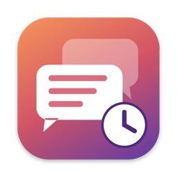
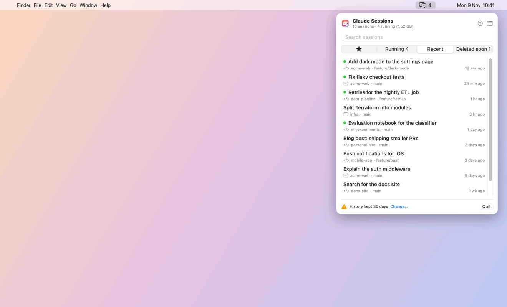
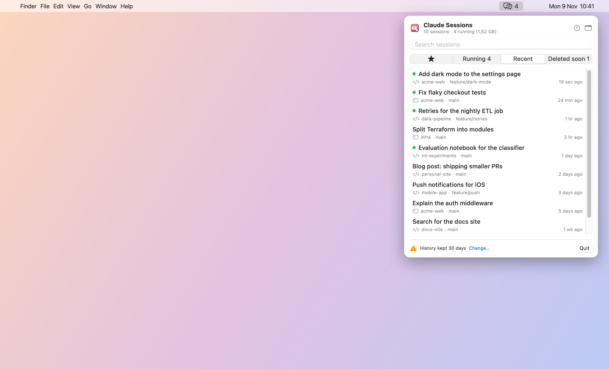
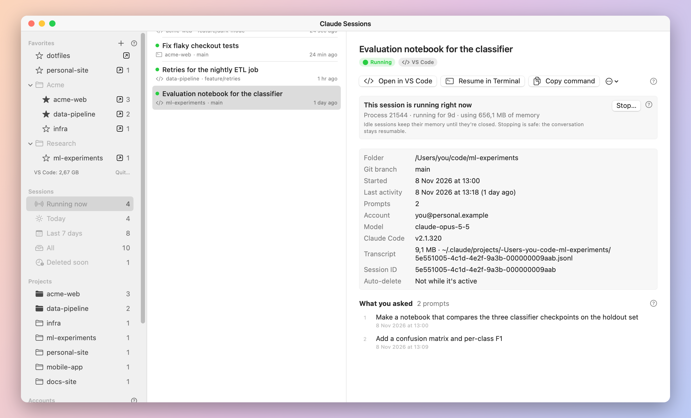
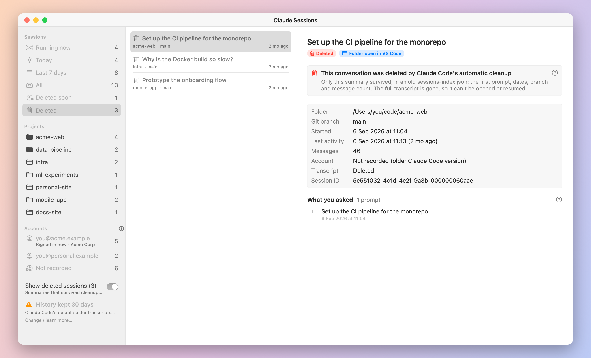
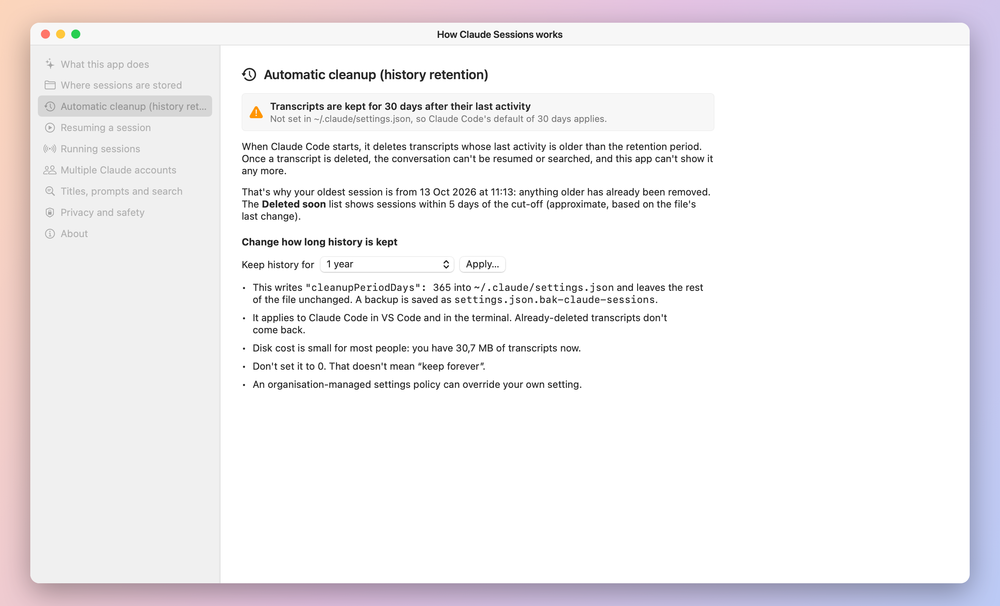

<p align="center">
  
</p>

<h1 align="center">Claude Sessions</h1>

<p align="center">
  <b>Every Claude Code conversation you've had, in one place.</b><br>
  A tiny native macOS menu bar app to find, resume and tidy up your Claude Code sessions,<br>
  across every project, VS Code window and terminal.
</p>

<p align="center">
  
  
  
  
</p>

<p align="center">
  
</p>

<p align="center"><sub>All data in the screenshots is made-up sample data.</sub></p>

---

## Why

Claude Code saves every conversation, but shows them **one project at a time**. If you work across
many repos and VS Code windows, it's easy to lose track of:

- *Which window was that conversation in?*
- *Which sessions are still running and eating memory?* (Idle tabs keep a `claude` process alive for weeks.)
- *Why did last month's conversation disappear?* (Claude Code **auto-deletes transcripts after 30 days** by default.)

Claude Sessions reads Claude Code's local files and answers all three.

## Features

| | |
|---|---|
| 🗂 **All sessions, one list** | Every conversation from every project, newest first, with AI-generated titles, project, git branch and VS Code/terminal source. Full-text search across titles and every prompt. |
| 🔗 **Links** | Pull requests, published artifacts, and every HTML file the session wrote. Open it in your browser or show it in Finder. |
| ▶️ **One-click resume** | **Open in VS Code** opens the project, then that exact conversation in the Claude Code extension. **Resume in Terminal** runs `claude --resume <id>` in the right folder. Or copy the command. |
| 🟢 **Running now** | See which `claude` processes are alive, for how long, and how much memory each uses. Stop idle ones safely. The conversation stays resumable. |
| ⏳ **Deleted soon** | See which conversations Claude Code's cleanup will delete next. Change the retention period (e.g. 1 year) from the app, with a backup of your settings. |
| 👥 **Multiple accounts** | Sessions are grouped by the Claude account that owned them, so work and personal stay distinguishable. |
| 🗑 **Deleted sessions** *(optional)* | Summaries of already-deleted conversations that survive in old index files. Off by default. |
| ❓ **Built-in help** | Every screen has a **?** that explains how Claude Code stores, cleans up and resumes sessions. |

<p align="center">
  
  
</p>
<p align="center">
  
  
</p>

## Install

### Download

1. Download **Claude-Sessions.zip** from the [latest release](../../releases/latest).
2. Unzip it and move **Claude Sessions.app** to your Applications folder.
3. Open it. The icon appears in the menu bar.

The app isn't signed with an Apple Developer ID yet, so macOS blocks the first launch
("Apple could not verify…"). Allow it once:
**System Settings → Privacy & Security → scroll down → Open Anyway.**
Or in Terminal:

```sh
xattr -dr com.apple.quarantine "/Applications/Claude Sessions.app"
```

### Build from source

Needs only the Xcode Command Line Tools (`xcode-select --install`), no Xcode.

```sh
git clone https://github.com/aibyos/claude-sessions.git
cd claude-sessions
./build.sh            # builds, installs to ~/Applications and launches
```

| Script | What it does |
|---|---|
| `./build.sh` | Build for this Mac, install to `~/Applications`, launch |
| `./build.sh --no-install` | Build only, into `build/` |
| `./package.sh` | Universal (Apple Silicon + Intel) build, zipped to `dist/Claude-Sessions.zip` |

`build.sh` includes a workaround for a known Command Line Tools issue (a duplicate
`SwiftBridging` module map) that otherwise breaks `import SwiftUI`.

Requirements: macOS 15 Sequoia or later, Claude Code (VS Code extension and/or CLI).
To launch at login: System Settings → General → Login Items → add Claude Sessions.

## How it works

Claude Sessions only reads files Claude Code already writes on your Mac:

| What | Where |
|---|---|
| Conversations | `~/.claude/projects/<project>/<session-id>.jsonl`, one JSON Lines file per session |
| Running sessions | `~/.claude/sessions/<pid>.json`, checked against live processes |
| Open VS Code windows | `~/.claude/ide/*.lock` |
| Deleted-session summaries | old `~/.claude/projects/<project>/sessions-index.json` files |
| Accounts | the `session-owner` record in each transcript, names from `~/.claude.json` |
| Retention | `cleanupPeriodDays` in `~/.claude/settings.json` (default **30 days**) |

Transcripts can be tens of MB, so the app only decodes the few records it needs (titles, prompts,
links) and caches an index in `~/Library/Caches/ClaudeSessions`. A full index of ~500 MB of
transcripts takes under a second; after that only changed files are re-read. Running sessions refresh
every 5 seconds and transcripts every 30.

**Resuming in VS Code** uses the Claude Code extension's own URL handler,
`vscode://anthropic.claude-code/open?session=<id>`. **Resuming in Terminal** runs
`cd <project> && claude --resume <id>` (sessions are stored per project, so it must run from the
original folder).

## Privacy

- **Read-only**: transcripts are never edited or deleted.
- **Local only**: no network access, no analytics. Nothing leaves your Mac.
- **One exception, on request**: the retention setting. It's only changed when you press *Apply*
  and confirm, and `settings.json` is backed up first.

## FAQ

**I use more than one Claude account. Are my sessions separate?**
No. All accounts on a Mac share `~/.claude`, so their sessions are mixed, in this app and in
Claude Code's own `/resume`. Newer Claude Code versions record the owning account per session, which
the app shows. You can resume any session whichever account is signed in, but new messages run under
the account signed in **now**. For full separation, use `CLAUDE_CONFIG_DIR` per account.

**Why are my older conversations missing?**
Claude Code deletes transcripts 30 days after their last activity unless `cleanupPeriodDays` is set.
Open **? → Automatic cleanup** to raise it. Already-deleted transcripts can't be recovered.

**Some running sessions say "nothing saved".**
A `claude` process is running but has no transcript: usually a VS Code tab that was opened and never
used, or one whose transcript was already cleaned up while the tab stayed open. It still uses
memory, and stopping it is safe.

## Contributing

Issues and pull requests are welcome. To regenerate the screenshots and GIF from sample data:

```sh
./build.sh --no-install
"build/Claude Sessions.app/Contents/MacOS/ClaudeSessions" --make-media docs
```

## Author

Made by **Orkhan Amrullayev** ([orkhan.amrullayev@gmail.com](mailto:orkhan.amrullayev@gmail.com)) at
**[AIBYOS](https://aibyos.com)**, AI by OmniSync: AI engineering, platforms and sovereign GPU compute.

## License

[MIT](LICENSE) © 2026 Orkhan Amrullayev

<sub>Claude Sessions is an independent project and isn't affiliated with or endorsed by Anthropic.
Claude and Claude Code are trademarks of Anthropic.</sub>
